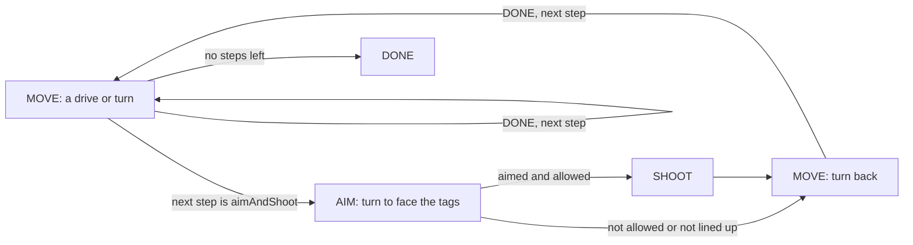

# BIOBUZZ robot code: start here

For students. This page tells you which program to run, how to run it, and how to read
the Java. The [reference](biobuzz-starterbot.md) lists every setting and the hardware
names for each robot. The step-by-step exercises and worksheets are in the lessons
(Meetings 5 to 13) in the `ftc-2026` repository.

The numbers in the code are starting values. None has been measured on our robots yet.

## Where the code is

Everything is under `TeamCode/src/main/java/org/firstinspires/ftc/teamcode/biobuzz/`,
in three folders:

| Folder | What is in it | You open it when |
|---|---|---|
| `programs` | The seven programs you can pick on the Driver Station. | You want to see what a program does. |
| `settings` | `Routes` (the autonomous step lists) and `ShooterCalibration` (the speed table). | You have measured something and need to type it in. |
| `robot` | The parts the programs share: motors, driving, launcher, camera, heading. | You want to know how a part works. |

## The programs

| Driver Station name | File in `programs` | What it does |
|---|---|---|
| TeleOp | `TeleOpBasic.java` | Drive from the gamepad; run the intake and launcher. No camera needed. |
| TeleOp with Aiming | `TeleOpAim.java` | The same, plus hold A to face the chosen tags. |
| Autonomous One Action | `AutoOneAction.java` | The smallest autonomous: one drive, then stop. |
| Autonomous Route | `AutoFollowRoute.java` | Carries out a route: a list of drives, turns and aim-and-shoot steps. |
| Tune Drive | `TuneDrive.java` | One 24-inch drive or one 90-degree turn, so you can measure it. |
| Tune Shooter | `TuneShooter.java` | Change the launcher speed in small steps and see which speed hits from each distance. |
| Tune Launcher PIDF | `TuneLauncherPidf.java` | Change the launcher's P and F and watch how it reaches and holds speed. |

## Run a program

1. Check `ROBOT` in `robot/StarterRobot.java` names the robot on the table.
2. Build and install from Android Studio. Saving a file does not update the robot.
3. Pick the program on the Driver Station and press **INIT**. Read the screen. The
   `Battery` line shows the voltage and GOOD, SWAP or CHARGE.
4. Put the robot on its start mark. Clear the area. One person keeps a hand on **STOP**.
5. Press **START**. When the motion ends, write down what the screen says, press
   **STOP**, and only then go to the robot.

Programs that move by themselves stay still until the mentor has set the setup
switches: `MOUNTING_CONFIRMED` in `robot/Heading.java` and `MOTION_ENABLED` in
`robot/StarterRobot.java`. Feeding by itself also needs `FEED_ENABLED`.

## Controls (gamepad 1)

**TeleOp**

| Control | Result |
|---|---|
| Left stick up/down | Drive forward/backward. |
| Right stick left/right | Turn. |
| Right trigger / left trigger | Intake in / out. |
| Hold right bumper | Spin the launcher; it feeds once the wheel is fast enough. |

**Choosing a target (camera programs, during INIT):** D-pad left = RED, right = BLUE,
up = the SCORING cell (the far side: the side of the field opposite the audience), down = the AUDIENCE cell.
These are FIRST's names for the two groups of tags.

**TeleOp with Aiming:** hold **A** to turn toward the tags. **A + right bumper** feeds,
but only when the tags are in view and centred, the speed table covers the range, and
the wheel is at speed.

**Autonomous Route (INIT):** **A** or **B** picks start A or B. **X** switches dry run
on or off. Dry run is on to begin with: the robot drives and aims but never shoots.

**Tune Drive (INIT):** D-pad up/down = 24 inches forward/back, left/right = 90-degree turn.

## Measure things in this order

Change one number at a time, build, and repeat the same test.

| Step | What to do | Where the number is |
|---|---|---|
| 1. Which robot | Tell the code which robot it is on. | `ROBOT` in `robot/StarterRobot.java` |
| 2. Drive direction | Wheels off the floor: stick forward rolls both sides forward. | `robot/StarterRobot.java` |
| 3. Hub direction | The [Hub check](biobuzz-starterbot.md#check-the-hub-direction-before-any-automatic-driving). | `LOGO`, `USB`, `MOUNTING_CONFIRMED` in `robot/Heading.java` |
| 4. Distance and turns | Tune Drive: ask for 24 inches and 90 degrees, measure with a tape. | Your robot's `TICKS_PER_INCH_…` line in `robot/Drive.java` |
| 5. Shooting | Tune Shooter: find the speed that hits from each range. | The table in `settings/ShooterCalibration.java` |
| 6. Route | Autonomous Route with dry run on, until it ends in the right place. | Your list in `settings/Routes.java` |
| 7. Shooting in autonomous | Dry run off, after `FEED_ENABLED` is set. | `FEED_SECONDS` in `robot/ShotTimer.java` |

Start each measuring session on a battery that says GOOD. If it says SWAP, change it and
repeat one measurement you already made to check it still agrees.

## Read the code

Read in this order. Each step adds one idea.

**1. `TeleOpBasic`: inputs to outputs.** Read `loop()`. It runs many times a second.
Each time, it reads the sticks and buttons and tells the robot what to do.
`robot.arcadeDrive(forward, rotate)` is the only way any program moves the wheels.

**2. When your methods run.** The FTC software calls them; you never call them yourself.

| Method | When | What goes in it |
|---|---|---|
| `init()` | Once, at INIT | Find the hardware. |
| `init_loop()` | Repeatedly until START | Menus and things to read before starting. |
| `start()` | Once, at START | Begin the first action. |
| `loop()` | Repeatedly until STOP | Check sensors, decide, set outputs. |
| `stop()` | Once, at STOP | Switch everything off. |

`loop()` must return quickly. It never waits for the robot to arrive somewhere.

**3. `AutoOneAction`: start once, check every loop.** `start()` gives one command:

```java
drive.driveInches(LEAVE_INCHES, timer.seconds());
```

`loop()` asks how it is going and changes the program's **state** when it finishes:

```java
Drive.Result result = drive.update(timer.seconds());
if (result == Drive.Result.DONE) {
    state = State.DONE;
} else if (result == Drive.Result.FAULT) {
    fail(drive.reason());
}
```

The program is always in one state: MOVE, DONE or FAULT. A FAULT means a check failed
and the robot stopped on purpose.

**4. `AutoFollowRoute`: the same thing with a list.** It has the same fields, the same
checks in `start()`, and the same MOVE, DONE and FAULT states. `beginStep()` gives the
command for the next line of the route. An `aimAndShoot()` line adds two states:



**5. `TeleOpAim`: the camera.** `TagCamera.update()` reads the tags. `turn()` suggests a
turn power and `mayFeed()` says whether feeding is allowed. The program still decides.

## What each file in `robot` is for

| File | Job |
|---|---|
| `StarterRobot` | Which robot this is, its hardware names, and the only methods that power a motor or servo. |
| `Drive` | Drives one distance or turns one angle, and says RUNNING, DONE or FAULT. |
| `Heading` | Which way the robot is facing, from the Hub's sensor. The Hub mounting settings are at the top. |
| `Launcher` | Runs one shot: spin up, wait for speed, feed, stop feeding. `startShot` is the only way to start one. |
| `ShotTimer` | Decides which phase of a shot we are in. No hardware. |
| `TagCamera` | The camera: finds the chosen tags, reports range and bearing, decides "aimed". |
| `TargetSelection` | Remembers the alliance and cell chosen on the D-pad. |
| `HeldFor` | Answers "has this been true for long enough?" (arrived, aimed, at speed). |

## If something does not work

| What you see | Check |
|---|---|
| Program missing from the list | The build installed, and you are looking at the right list (TeleOp or Autonomous). |
| Hardware name error at INIT | The Driver Station configuration matches the names for this robot in `StarterRobot`. |
| "Not moving: …" | A mentor's setup switch is still off. The message names it. |
| Tags not seen | Alliance and cell chosen, the right sheets on the wall, camera tilted up, good light. |
| Drive/turn timeout | Something blocked a wheel, or the drive is too long for 4 seconds. |
| "Shot skipped: …" | The message says why: dry run, `FEED_ENABLED`, or no speed-table rows around that range. |
| Launcher spins but will not feed in TeleOp with Aiming | Hold A and right bumper together; the tags must be centred and the range inside the table. |

## Words

- **OpMode:** one program you can pick on the Driver Station.
- **Telemetry:** what a program prints on the Driver Station screen.
- **Encoder ticks:** counts from a motor's built-in sensor. We use them for distance and for launcher speed (ticks per second).
- **IMU:** the sensor inside the Control Hub that tells which way the robot faces.
- **Heading:** the direction the robot faces, in degrees. Turning right makes it go up.
- **Range / bearing:** how far away the tags are / how far left or right of the camera's centre.
- **State:** which part of a job a program is doing right now.
- **Enum:** a short list of named choices, such as MOVE, DONE, FAULT.
- **NaN:** "Not a Number". We use it to mean "no reading".
- **Tolerance:** how close counts as close enough.
- **Proportional gain:** correction = error × gain. Ten degrees of error × 0.015 asks for 0.15 power. A separate maximum limits it.
- **PIDF:** the launcher's speed controller. Meeting 13 explains it.
